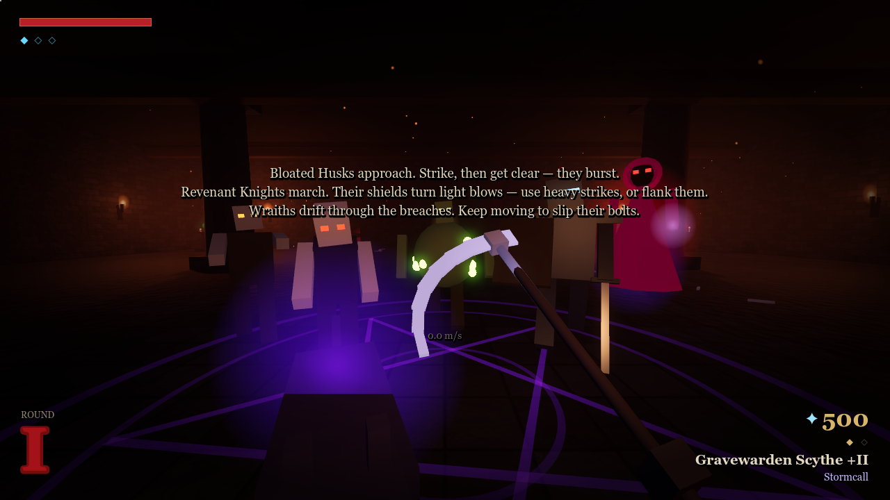
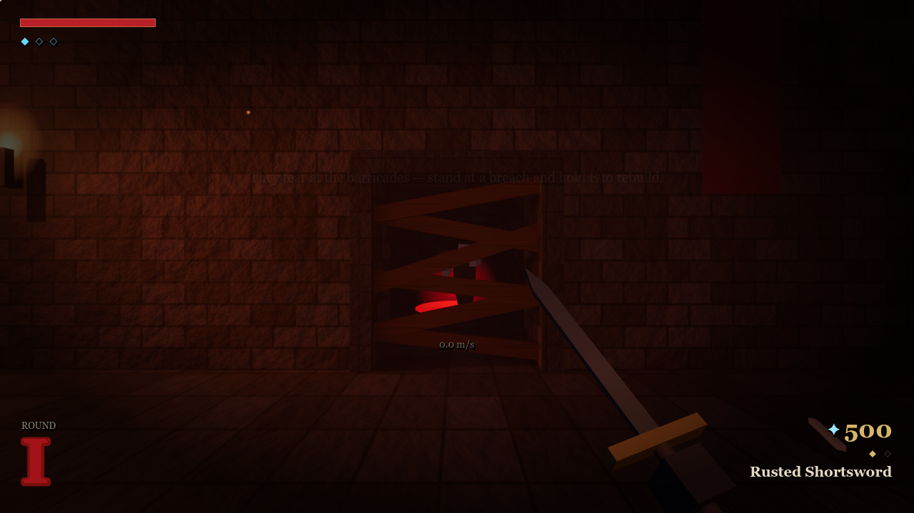
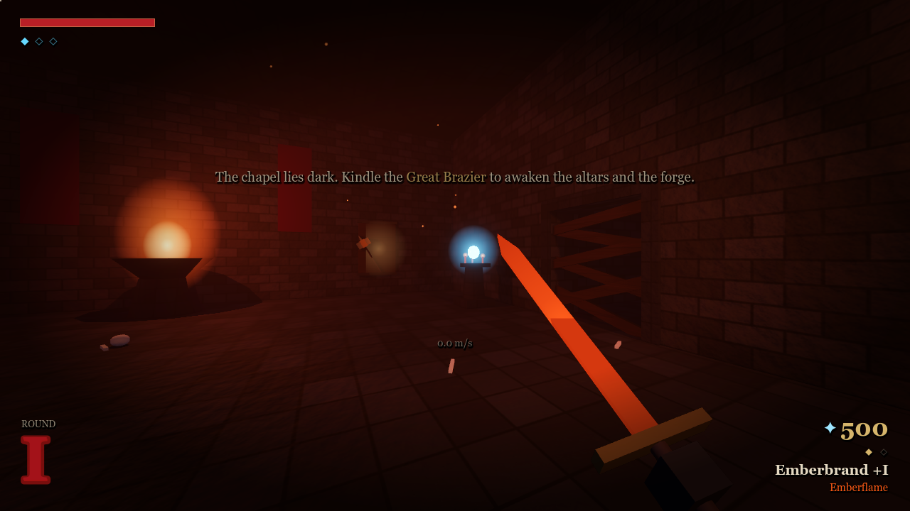

# Ashen Vigil

Dark-fantasy co-op wave survival. Hold a ruined crypt against endless rounds of the dead. They rise outside and tear through the boarded breaches; you rebuild the barricades, fight them off with swords, scythes and maces, and spend their souls on better weapons and blessings.

## ⬇ Download (Windows)

**[Download the latest version](https://github.com/themanselmo/ashen-vigil-releases/releases/latest/download/AshenVigil.zip)**

All versions: [Releases](https://github.com/themanselmo/ashen-vigil-releases/releases)

1. Unzip it anywhere and run `AshenVigil.exe`. Nothing to install.
2. If Windows says *"Windows protected your PC"*, click **More info → Run anyway**. The game isn't code-signed yet, so Windows asks once.

## Play together (up to 4)

- **Online, from anywhere:** click **PLAY ONLINE**. One person clicks **HOST ONLINE GAME** and shares the 5-letter room code; everyone else types the code and clicks **JOIN**. No firewall or router setup.
- **Same network (LAN):** click **HOST LAN GAME** / **JOIN LAN GAME**. Games on your network show up automatically.

If a friend goes down, hold **E** beside them to revive them before they bleed out.

## Controls

| Key | Action |
|---|---|
| WASD / Mouse | Move / look |
| Space or Mouse wheel down | Jump (bunny hop: jump the moment you land to keep your speed) |
| Left click (hold) | Light attacks |
| Right click (hold) | Heavy attacks |
| E | Interact / buy; hold to rebuild barricades or revive |
| Q, Mouse wheel up, 1–3 | Swap weapon |
| R | Soul Lance (spell) |
| Esc | Menu / settings |

**Air strafing:** in the air, hold A or D and turn the mouse the same way to gain speed.

## Tips

- Kill enemies and rebuild barricades for **souls**. Spend them on wall weapons, the **Cursed Reliquary** (a random weapon) and the sealed chapel door.
- Light the **Great Brazier** in the chapel to wake the perk altars and the **Soul Forge**, which upgrades your weapon.
- **Revenant Knights** block light attacks from the front. Use heavy attacks or hit them from the side.
- **Bloated Husks** explode when they die. Get clear!

---
This repository only hosts downloads. Found a bug? Tell the developer.
